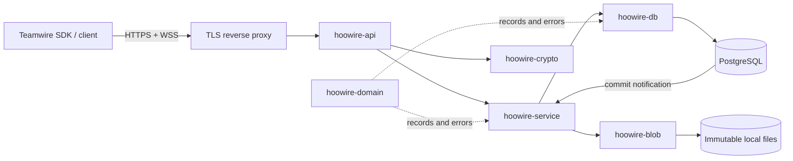

# Architecture

HooWire separates protocol compatibility from application rules and persistence.
The executable composes seven workspace crates into one native process.

## Crate boundaries

`hoowire` reads configuration, provisions accounts and integrations, runs explicit
migrations and starts the listener. Protocol routing and SQL do not live in the
executable.

`hoowire-api` translates API 20 paths, encrypted request/response envelopes and
WebSocket frames. Wire model names and legacy shapes stay at this boundary.
Application errors map to HTTP responses. Unknown operations fail explicitly.
The adapter limits concurrent requests, WebSockets and request bodies.

`hoowire-service` owns authentication, persistent human sessions and short-lived
handshakes and WebSocket tickets, provisioning, authorization orchestration and
master-key sealing. Password hashing uses a bounded blocking worker budget. One
process-wide PostgreSQL
listener turns commit notifications into WebSocket wake-ups; periodic durable
catch-up covers missed notifications.

`hoowire-domain` defines records and validation without SQL or HTTP dependencies.
`hoowire-db` implements parameterized PostgreSQL queries, tenant constraints,
transaction boundaries and migrations. Repository operations have focused
modules for accounts, chats, messages, preferences, directory entries, feeds,
assets, avatars, locations, authenticated sessions and other resources. Shared
transaction helpers keep event emission and row mapping consistent.
`hoowire-crypto` implements the observed SDK transport and key exchange.
`hoowire-blob` publishes immutable
UUID-addressed files and verifies their SHA-256 digest when reading.

## Write and replay path

A conversation write acquires the conversation row lock. Membership and
administrator checks, optimistic version checks, mutation and recipient event
inserts execute in one transaction. Recipient counters are locked in sorted
UUID order. The counter and event commit together, so event cursors cannot skip
an earlier uncommitted sequence number. `NOTIFY` is a wake-up hint delivered
only after commit; PostgreSQL's durable event table is the replay authority.
For a nonempty recipient set, event fan-out uses four bulk SQL statements to
lock recipients, increment counters, insert events and issue notifications.
Database work and event storage still grow with the recipient count.

Message request fingerprints preserve retry identity even after metadata edits
or tombstones. Read markers never move backward. Private attachment uploads gain
conversation grants only when an authorized sender posts a reference; forwarding
adds another grant. Message insertion and attachment authorization either commit
together or roll back together.

The API's legacy timestamp ETags map to durable outbox positions stored in
PostgreSQL. Two messages with identical wall-clock timestamps remain separately
pageable. Idle polls reuse an unchanged token. See [data](data.md) for bounds,
retention and the exact storage guarantees.

## Runtime and state

The serving process requires PostgreSQL, an asset directory and one 32-byte
master key. It does not require a Python or Node.js runtime, a separate cache or
a broker. TLS terminates at a reverse proxy; PostgreSQL uses verified TLS when
connecting beyond an isolated development network.

Authenticated human sessions live in PostgreSQL with a one-hour expiry checked
against database time on every authentication. Only the `From` token hash is
stored; the transport key is sealed by the master key and bound to the token,
tenant and user. Logout persists revocation and emits a transactional wake-up.
Open login handshakes and single-use WebSocket tickets remain in process memory,
expire after 120 and 60 seconds respectively, and are lost on restart. Persisted
messages, memberships, assets, event cursors and unexpired authenticated sessions
survive restart. SDK integration credentials remain in PostgreSQL as sealed
envelopes.

The initial deployment target is a single service instance. Multiple instances
would need shared asset storage with the required immutable publication
semantics, the same master key, and routing affinity while completing a login
handshake or consuming a process-local WebSocket ticket. Authenticated human
sessions and their revocation are shared through PostgreSQL. Shared database
state and notifications alone do not qualify a multi-instance deployment.

## Graceful shutdown

SIGTERM or Ctrl+C signals the application and stops HTTP acceptance. Each
WebSocket task observes shutdown outside its entire protocol loop, so an
in-flight database read or replay batch can be cancelled before closing the
socket. It sends Close 1001 (Going Away) and waits for the peer's close response
within one shared one-second budget. A connection upgraded after the signal
uses the same close path.

The HTTP server drains its requests first. The adapter then waits up to three
seconds for every WebSocket permit to be released, covering both pending
upgrades and active sessions. This explicit wait completes before the executable
closes its database pool and returns from the Tokio runtime. Exceeding the
WebSocket drain budget returns an error. Deployment stop deadlines must cover
the 30-second HTTP operation timeout, this drain budget and scheduling overhead.

## Compatibility and performance evidence

The interoperability target is a specific external SDK and API version.
Protocol observations, synthetic Rust tests, real PostgreSQL integration tests
and runs of an unmodified SDK provide different evidence. None alone proves
complete Teamwire parity or production readiness. Refer to the
[compatibility report](compatibility.md) before expanding claims.

Release builds use thin LTO, one code generation unit, stripped symbols and
abort-on-panic. Work is asynchronous; HTTP operations, uploads, password workers,
WebSockets, handshake maps, ticket maps and the application broadcast channel
have explicit capacity bounds. The SQLx connection pool is bounded, while
`PgListener` internally buffers notifications in an unbounded channel. Idle
WebSockets share one database listener. Throughput, latency and memory
under load require a reproducible benchmark. The separate
[runtime observations](runtime-measurements.md) record artifact sizes and one
idle container sample.
